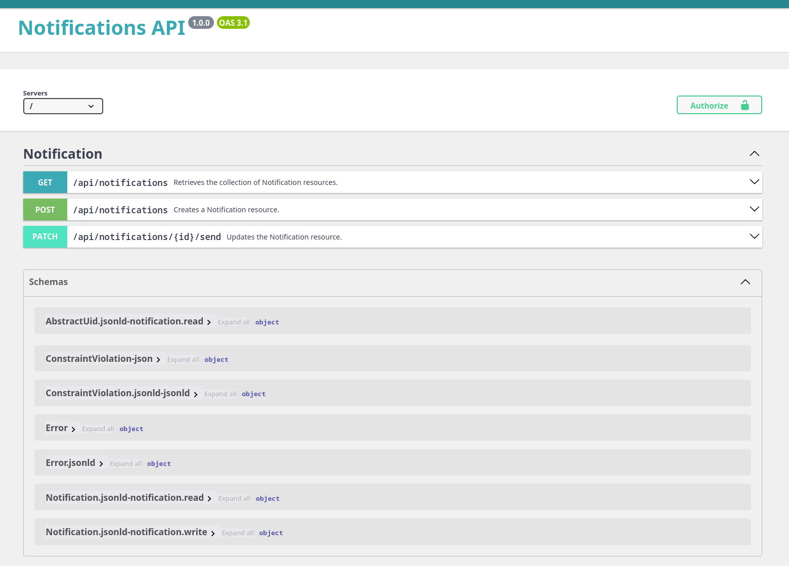
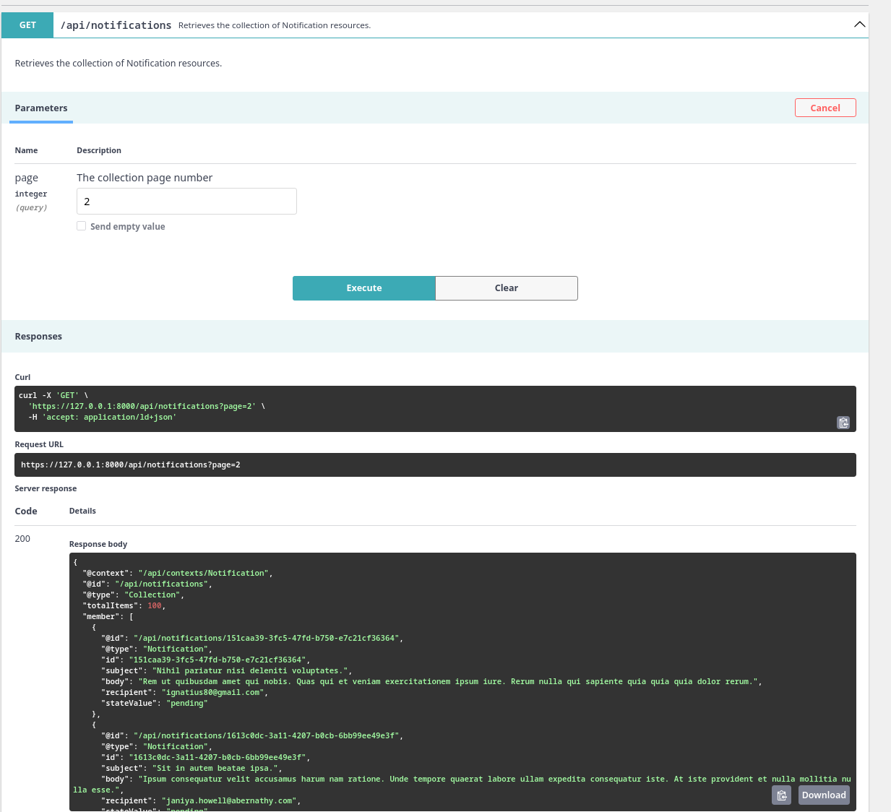
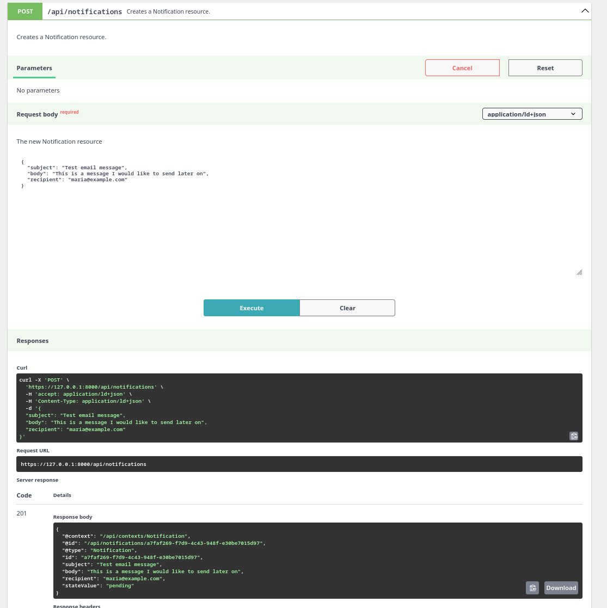
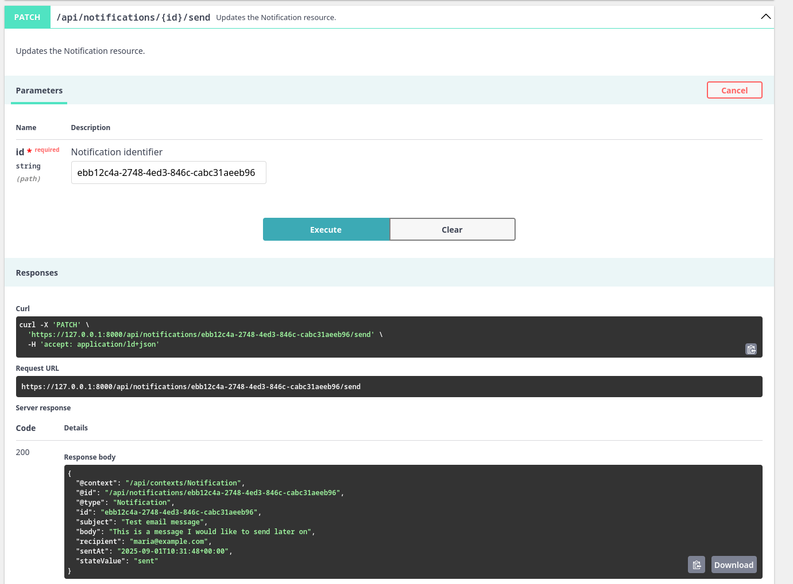
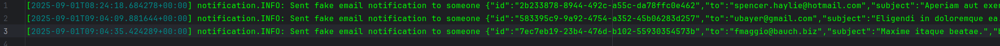

# Basic (Email) Notifications API 



# Code quality tools

This project uses the following code quality tools:
- [PHPStan](https://phpstan.org/) for static analysis
- [ECS Fixer](https://cs.symfony.com/) for coding standards
- Rector

# Architecture

This project leverages the following libraries and architecture:
- [Symfony 7.3](https://symfony.com/) 
- [API Platform 3](https://api-platform.com/) to build the API
- [Doctrine ORM](https://www.doctrine-project.org/projects/orm.html) for database
- [Docker](https://www.docker.com/) to run a database in a container
- [PHPUnit](https://phpunit.de/) for testing
- [Makefile](https://www.gnu.org/software/make/) to automate common tasks


## Project Structure

As this is a minimal test project, I've decided to follow the default Symfony standard project structure. In a larger project, I would consider
resorting to a Domain-Driven Design (DDD) approach, organizing the code into distinct domains or bounded contexts coupled with CQRS pattern.

## API Platform

I've decided to resort to API Platform as I believe API Platform provides a robust set of tools and features that simplify the process 
of building and maintaining APIs, allowing developers to focus on business logic rather than boilerplate code. Most importantly,
its solid set of standards and best practices help ensure that the API is well-designed, secure, and scalable, particularly when 
it comes to handling serialization, validation, pagination. Its built-in Swagger & Open API documentation also makes the API super easy
to test out.

## Validation

The project uses Symfony's built-in Validation component. This includes validating `recipient` is an email address and ensuring required fields are present.

## Serialization groups

Serialization groups are used to control which fields are included in API responses and requests. This helps ensure that clients only see the data they need and cannot modify fields they shouldn't by separating normalization & denormalization Contexts.
For example, the `stateValue` field is read-only and cannot be set when creating a new notification. It can only be modified by the system when marking a notification as sent via the workflow state machine.

## State Processor

The PATCH operation relies on a custom state processor to handle updates to the `state` field.
This processor leverages API Platform's Doctrine ORM persist processor to handle the actual database update after performing necessary validation and state transition logic.
That processor calls the Workflow component to apply the state transition before "sending" the notification via the fake notification sender.
The order of steps here and the SRP principle aren't exactly perfect here as the state processor is doing a bit more than just processing the state, but for the sake of simplicity and time constraints, I opted for this approach.
I believe we should probably split the logic (and possibly swap its order) here into a dedicated service for notification sending if this was an actual production project.

## State Machine

The project uses the [Symfony Workflow component](https://symfony.com/doc/current/components/workflow.html) to manage the state of notifications.
The workflow defines two states:`pending` and `sent` (which are enums).
Notifications are created in the `pending` state by default and can be transitioned to the `sent` state via the `send_notification` API operation at `api/notifications/{id}/send`.

## Event Listener

I plugged an event listener on the `send` transition of the Workflow State Machine to dynamically set the `sentAt` field when a notification is marked as sent.

# Using and testing out the API

If you've got the Symfony CLI & PHP on your local machine can setup the database and run the project with:

```
make basic-install
```

Once you've got the server running, you can check out the API documentation at:

```
https://127.0.0.1:8000/api
```

You can also access the OpenAPI documentation directly at:

```
https://127.0.0.1:8000/api/docs.jsonopenapi
```

## Sample data

The project contains dev fixtures to populate the database with some sample data to help you test out the API. The `make basic-install` command will load these fixtures for you.
By default, all notifications are marked as pending (i.e. not sent yet).

## Endpoints

You can list notifications, create new ones, and mark them as sent.

# Listing Notifications



# Creating a Notification

Creating a notification requires a `subject`, a `recipient` (an email address), and a `body`. Serialization groups mean that 
even though the user could attempt to set the `state` or `sentAt` fields, they will be ignored. They can't set extra fields either.
The system will ignore them and only persist the fields that are part of the `notification:write` group.



# Sending a Notification

Sending a notification requires only its `id` and is done via a custom operation at `api/notifications/{id}/send`.
When sent, the notification is transitioned from the `pending` to the `sent` state, and its `sentAt` field is set to the current date and time.



## Fake notifications system

For the sake of simplicity, this project does not include a real notification system. Instead, it simulates sending notifications by logging messages to a file.
You can find the log file at `var/log/dev_notifications.log` or `var/log/test_notifications.log`. Whenever a notification is "sent", a message will be appended to this file.
It uses a dedicated monolog channel called `notifications` to separate these logs from other application logs.



# Test suite

Setup the test environment and database with:

```
make test-install
```

You can run the test suite with:

```
make test
```

Tests rely on data fixtures, stories and factories thanks to Foundry, as well as DAMADoctrineTestBundle to reset the database.

## Next steps

From here, the next logical steps for this API would be to actually implement the sending notification interface via email. 
I would most likely recommend using [Symfony's Notifier component](https://symfony.com/doc/current/notifier.html) (which integrates Symfony Mailer in its Email channel) to send real emails with Symfony Messenger to have an asynchronous queueing system with retries, failures etc.
This would then entail adding new states to the state machine such as `failed` to better track the status of notifications.
We could also imagine that notifications could be filtered by their state using API Platform filters.
Then, if needs be, we could imagine opening up the API to support other notification types such as SMS or push notifications.
